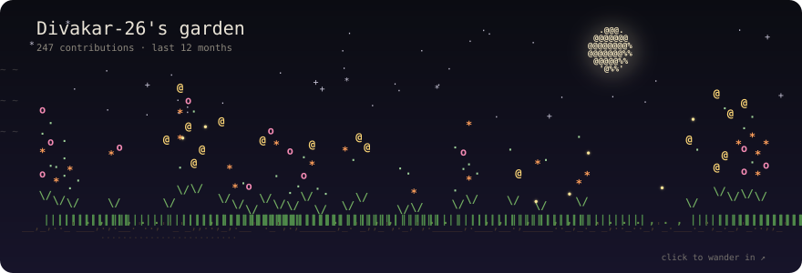

# ASCIIWall

Live, interactive ASCII-art wallpapers. Every scene is a small world rendered in a shader you never see, drawn back to you one coloured glyph at a time. Each one reacts when you move or tap: koi come to look at your cursor, the sea leaves a wake, fireflies follow you, and fogged glass wipes clean.

<a href="https://YOUR_USER.github.io/ASCIIWall/?scene=garden">
  <picture>
    <source media="(prefers-color-scheme: light)" srcset="assets/garden-light.svg">
    
  </picture>
</a>

## The library

| Scene | Style | Interaction |
|---|---|---|
| **The Ring** | dense glyphs | a gold ring above embers; bring your cursor near and fiery script wakes on it; drag to turn |
| **The Beacons** | soft glyphs | snowy peaks above a sea of cloud; tap and signal fires leap from summit to summit |
| **Meadow Walk** | soft glyphs | first-person stroll through wildflowers at sunset, fireflies and butterflies; hold to stop |
| **Beating Heart** | glyphs + edges | drag to turn it; hover quickens the pulse; tap for a hard beat and a spurt |
| **Black Hole** | dense glyphs | raytraced lensing; drag to orbit; tap for a flare |
| **Spiral Galaxy** | dense glyphs | volumetric 3D; drag to orbit; tap for a supernova |
| **Earthrise** | dense glyphs | drag to spin the globe; your cursor moves the sun |
| **Torus Knot** | dense glyphs | iridescent; drag to turn; tap to shift colour |
| **Still Life** | dense glyphs | Renaissance chiaroscuro; your cursor carries the candle that lights it |
| **Armillary Sphere** | dense glyphs | engraved brass instrument; drag to orbit; tap to spin the rings |
| **Florence** | dense glyphs | Brunelleschi's dome at golden hour; cursor moves the sun; swallows follow; tap for bells |
| **Butterflies** | sparkle glyphs | they follow you; tap one and it shatters into glitter and reforms |
| **Cloudscape** | halftone | your cursor parts the clouds; tap for lightning |
| **Torii Path** | edge glyphs | maple leaves swirl around you; tap the sea for ripples |
| **Koi Pond** | koi glyphs | eight koi varieties with scales and rayed fins; hover to attract, tap to feed, swipe to scare |
| **Moonlit Tide** | flow dashes | sweep across the water to leave a foamy wake; tap to splash |
| **Firefly Meadow** | binary glyphs | fireflies gather around you; flowers lean away as you pass |
| **Rainy Window** | glyphs | wipe the fogged glass; it slowly fogs over again |
| **Hearth** | glyphs | your movement is the wind; tap for a shower of sparks |
| **Jellyfish Drift** | glyphs | jellies drift toward you; tap to nudge them |
| **Aurora Cabin** | glyphs | the aurora gathers under your cursor; touch the lake |
| **Contribution Garden** | binary glyphs | your GitHub year as flowers; hover a plant to see its week |
| **Living Image** | glyphs | drop or paste any picture; the cursor works like a lantern |

## Run it

```bash
npm run serve        # → http://127.0.0.1:8080   (browser, no install needed)
npm start            # desktop app: tray + live wallpaper on every monitor
npm run library      # desktop app, library window only
```

Settings (`S`): density, edges, fill, glow, grain, motion, glyph set, tint, frame rate.
Keys: `←` `→` scenes · `L` library · `S` tune · `H` hide UI · `F` fullscreen · `space` pause.
URL options work too: `index.html?scene=tide&density=1.3&tint=amber&clock=1&ui=0`.

## Platforms

| Where | How |
|---|---|
| **Linux (X11 / XWayland)** and **macOS** | `npm start`. The desktop app puts a window on the desktop layer of every display, underneath your apps. It follows the cursor globally, so the scene still reacts when windows or icons are on top. |
| **Windows** | Windows doesn't let regular apps draw on the desktop layer. Use [Lively Wallpaper](https://www.rocksdanister.com/lively/) (free): drag the `web/` folder into it. `LivelyInfo.json` is included. **Wallpaper Engine** works too, via the included `web/project.json`. |
| **Any browser** | open `web/index.html` through a server (`npm run serve`) and go fullscreen. |
| **Android / iOS** | deploy `web/` (see GitHub Pages below), open it, then *Add to Home Screen*. It runs fullscreen and offline, with touch interaction. |
| **Any website** | the `<ascii-wall>` web component, shown below. |
| **GitHub README** | the animated contribution-garden SVG, which links to the live page. |

To build installers: `npm install && npm run dist` (AppImage/deb, dmg, nsis via electron-builder).

## GitHub: the contribution garden

READMEs on GitHub render SVG as an image, so CSS animation works but scripts and clicks don't. The garden comes in two parts:

1. **`assets/garden.svg`** (+ `garden-light.svg`): an animated ASCII garden for your README. Plants sway, fireflies wander and the stars twinkle.
2. **The live scene on GitHub Pages** (`?scene=garden`): fully interactive, with hover tooltips per week. The SVG links to it.

Setup:

1. Push this repo to GitHub. In **Settings → Pages**, set *Source* to **GitHub Actions**.
2. `.github/workflows/garden.yml` regrows the garden daily (or run it manually from the Actions tab). `.github/workflows/pages.yml` publishes `web/`.
3. Paste this into your profile README (`YOUR_USER/YOUR_USER/README.md`):

```html
<a href="https://YOUR_USER.github.io/ASCIIWall/?scene=garden">
  <picture>
    <source media="(prefers-color-scheme: light)" srcset="https://raw.githubusercontent.com/YOUR_USER/ASCIIWall/main/assets/garden-light.svg">
    
  </picture>
</a>
```

### Live koi pond

```html
<a href="https://YOUR_USER.github.io/ASCIIWall/?scene=koi">
  <picture>
    <source media="(prefers-color-scheme: light)" srcset="https://raw.githubusercontent.com/YOUR_USER/ASCIIWall/main/assets/pond-light.svg">
    
  </picture>
</a>
```

The koi animate right inside the README (SVG animation, no scripts); clicking opens the fully interactive pond where you can feed them.

### Contribution garden in the app

Open **tune** (`S`) and type your GitHub username: the garden grows from your real public contributions (fetched by `npm run serve`'s local server). On GitHub Pages it reads `web/data/contributions.json`, which the Action regrows daily.

### More widgets

`github/widgets.mjs` writes five more animated cards (each with a `-light` twin), regrown daily by the same Action:

| | |
|---|---|
| `assets/sky.svg` | a night-sky stats card: every repo is a star, sized by its stargazers |
| `assets/languages.svg` | your top languages as ASCII block bars with a sweeping glint |
| `assets/streak.svg` | a campfire that grows with your current contribution streak |
| `assets/tide.svg` | 26 weeks of contributions as a rolling ASCII sea |
| `assets/pond.svg` | **live koi pond**: koi swim, flex and turn among lotus pads; more fish the more you contribute (last 5 weeks) |

```html
<picture>
  <source media="(prefers-color-scheme: light)" srcset="https://raw.githubusercontent.com/YOUR_USER/ASCIIWall/main/assets/sky-light.svg">
  
</picture>
```

To generate it locally: `node github/garden.mjs --user YOUR_USER` (add `--token` for the GraphQL API, or `--demo` for fake data).

## Embed anywhere

```html
<script src="https://YOUR_USER.github.io/ASCIIWall/dist/asciiwall.js"></script>
<ascii-wall scene="tide" style="height:360px"></ascii-wall>
<ascii-wall scene="hearth" density="1.4" glow="1.2" tint="amber" fps="30"></ascii-wall>
```

Attributes: `scene density glow grain speed fps tint ramp interactive contributions`. A component pauses itself while it's off-screen. `npm run bundle` rebuilds `web/dist/asciiwall.js`, and `web/components.html` is a live demo page.

## How it works

```
ripple + trail sim  ──▶  scene shader  ──▶  ASCII composite
(cols×rows, half-float)  (1 texel / cell)    glyph · tile · flow + bloom, grain, vignette
```

- **Scene pass**: each scene is a GLSL function `vec4 scene(vec2 uv, vec2 p)` returning a colour plus glyph density (or a dash angle for flow scenes). It renders at exactly one texel per character cell, so scenes can be lavish and still cheap.
- **Composite**: picks a glyph from a canvas-built atlas by density, colours it with the cell's hue, and draws one of three styles: `glyph` (coloured characters), `tile` (characters sunk into coloured squares, like the koi), or `flow` (procedural dashes aligned to the surface, with dots for highlights). Bloom comes for free from the scene texture's mip chain.
- **Interaction**: a shared GPU wave-equation sim (ripples) plus a slow-fading trail channel (wakes, wiped fog), and per-scene JS sims (koi boids with follow-the-leader spines, fireflies, jellies, wind).

### Add a scene

Create `web/js/scenes/myscene.js` and add a `<script>` tag for it in `index.html` (and its name to `tools/bundle.mjs`):

```js
AsciiWall.registerScene({
  id: "myscene", name: "My Scene", blurb: "…", tags: ["calm"],
  style: "glyph",            // glyph | tile | flow
  ramp: "soft",              // or any string of glyphs, sparse → dense
  bg: "#07080c", cell: 9, aspect: 1.55, glow: 1,
  init(api) { return {}; },                       // optional JS state
  update(st, api) { api.data[0] = api.mouse.px; }, // optional: feed uData[0..63]
  frag: `
    vec4 scene(vec2 uv, vec2 p) {               // p: centred, y in [-0.5, 0.5]
      float d = length(p - uMouseP);
      vec3 c = vec3(0.9, 0.6, 0.3) * exp(-d * 8.0) * uMouseOn;
      return shade(c);                            // colour → glyph density
    }`,
});
```

Uniforms available: `uTime uGrid uAspect uMouse uMouseP uMouseOn uActivity uSim uTex uTexSize uData[64]`, plus helpers `noise fbm hash21 rot sdSeg sdBox ripple rippleGrad trail shade`.

## Notes and limits

- On the desktop, the wallpaper reacts to **cursor movement** everywhere. Clicks reach it only where nothing (icons, windows) sits on top.
- On GNOME, a desktop-icons extension draws its own desktop window, and the two may fight over stacking. Toggle the extension if the wallpaper hides.
- `Battery saver` in the tray (or `fps` in tune) caps the frame rate. On battery, the desktop app drops to 30 fps automatically.
- Running from a VS Code terminal sets `ELECTRON_RUN_AS_NODE=1`, which breaks Electron. The npm scripts strip it for you.
# ASCIIWall
